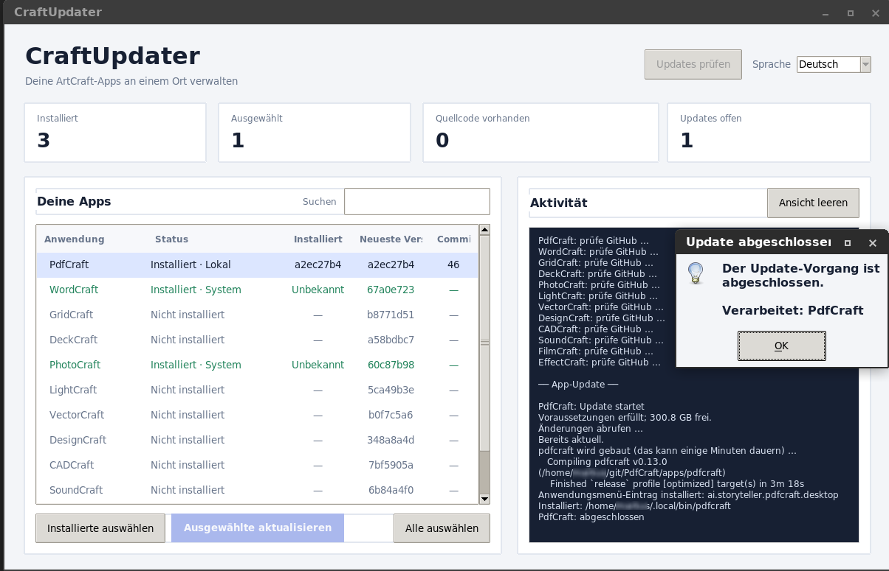

# CraftUpdater

A lightweight Linux desktop app for checking, building, and updating the open source ArtCraft applications from GitHub.



## Features

- Check GitHub for the latest commit of each supported app.
- See installed and available commit versions, plus the number of new commits when the local source repository is available.
- Detect common existing installations, including native programs, Flatpak, Snap, and AppImages.
- Build selected apps from source and install them into `~/.local/bin`.
- Check build tools, required development libraries, and free disk space before starting a build.
- Cancel a running operation. The existing managed executable is kept until the replacement has built successfully.
- Get a completion dialog listing the apps processed after a successful update operation.
- Switch the interface between German and English.
- View build output in the app and in a persistent log file.
- Open PDFs with PdfCraft from the file manager using **Open With**. The installed desktop entry passes selected PDF paths correctly; CraftUpdater keeps the `%U` file argument unquoted so the desktop environment can expand it.

## Supported applications

PdfCraft, WordCraft, GridCraft, DeckCraft, PhotoCraft, LightCraft, VectorCraft, DesignCraft, CADCraft, SoundCraft, FilmCraft, and EffectCraft.

## Requirements

- Linux, Python 3, and Tkinter
- Git, Rust, Cargo, `pkg-config`, and `nice`
- The development libraries required by the selected ArtCraft project
- An internet connection and sufficient free disk space

On Debian or Ubuntu, install the common prerequisites with:

```sh
sudo apt install python3 python3-tk git cargo build-essential pkg-config libgtk-3-dev libasound2-dev
```

## Run

Clone this repository, then start the GUI:

```sh
git clone https://github.com/wildcardcharacter/CraftUpdater-ArtCraft-App-Updater-for-Linux.git
cd CraftUpdater-ArtCraft-App-Updater-for-Linux
./craft_updater.py
```

To add CraftUpdater to your application menu and install a command in `~/.local/bin`:

```sh
./install.sh
```

Click **Check for updates**, select the apps you want to update, then click **Update selected** below the app list. CraftUpdater shows a confirmation dialog when the operation finishes successfully.

## How updates work

CraftUpdater clones each selected project from `github.com/storytold/<App>` and builds it with Cargo. The resulting executable is installed under `~/.local/bin`; system managed files are left untouched. The first build can take several minutes and use multiple gigabytes of disk space.

Before a build, CraftUpdater checks for the required build tools and selected system libraries, then checks available disk space. You can cancel Git and build operations. A new executable is copied to a temporary file and replaces the managed executable only after the build succeeds.

Installed commit versions are available for apps previously built by CraftUpdater. For installations made by other tools, the installed commit is shown as unknown. If an app's source repository has not been cloned yet, the latest GitHub commit is shown, while the commit count is unknown until the repository is available locally.

The language preference is saved in `~/.config/craft-updater-gui/settings.json`. The activity log is saved in `~/.local/state/craft-updater-gui/last-run.log`.

## License and affiliation

CraftUpdater is an independent, unofficial community project and is not affiliated with or endorsed by ArtCraft. See the repository license for the terms that apply to this project.
