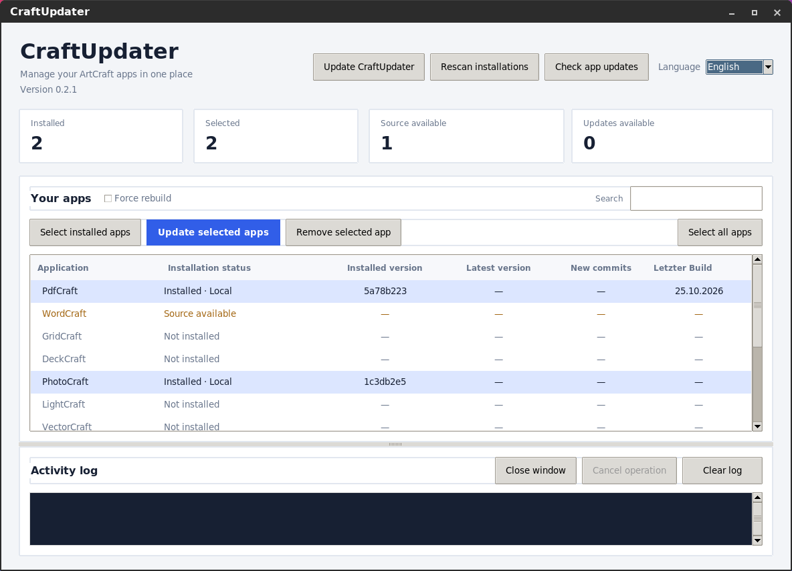
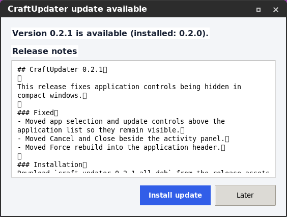
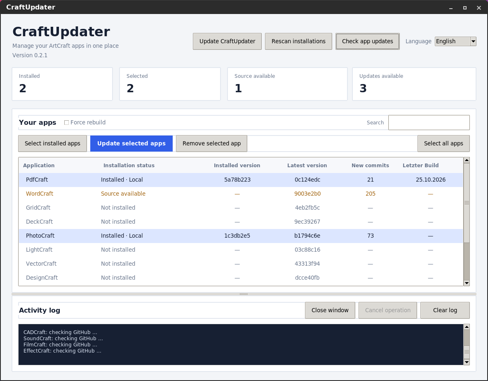
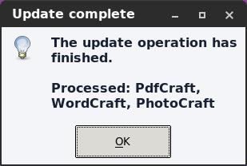

# CraftUpdater

A lightweight Linux desktop app for checking, building, and updating the open source ArtCraft applications from GitHub.

## Screenshots

**Application list, installation status, and activity log**



**Installing a CraftUpdater update**



**Checking for updates and viewing activity**



**Completion message**



## Features

- Check GitHub for the latest commit of each supported app.
- See installed and available commit versions, plus the number of new commits when the local source repository is available.
- Detect common existing installations, including native programs, Flatpak, Snap, and AppImages.
- Rescan every supported app and show the detected installation type and path in the activity log. Apps without a detected installation are reported as not installed.
- Build selected apps from source and install them into `~/.local/bin`.
- Check build tools, required development libraries, and free disk space before starting a build.
- Cancel a running operation. The existing managed executable is kept until the replacement has built successfully.
- Get a completion dialog listing the apps processed after a successful update operation.
- Switch the interface between German and English.
- Check GitHub Releases for CraftUpdater updates, review release notes, and install the new Debian package from the GUI with an administrator authentication prompt.
- View build output in the app and in a persistent log file.
- Resize table columns by dragging their dividers, or double-click a divider to fit the column to its heading and visible values. Resize the table and activity log areas by dragging their divider.
- Open PDFs with PdfCraft from the file manager using **Open With**. The installed desktop entry passes selected PDF paths correctly; CraftUpdater keeps the `%U` file argument unquoted so the desktop environment can expand it.

## Supported applications

PdfCraft, WordCraft, GridCraft, DeckCraft, PhotoCraft, LightCraft, VectorCraft, DesignCraft, CADCraft, SoundCraft, FilmCraft, and EffectCraft.

## Requirements

- Linux, Python 3, and Tkinter
- Git, Rust, Cargo, `pkg-config`, and `nice`
- The development libraries required by the selected ArtCraft project
- An internet connection and sufficient free disk space

On Debian or Ubuntu, install the common prerequisites with:

```sh
sudo apt install python3 python3-tk git cargo build-essential pkg-config libgtk-3-dev libasound2-dev pkexec
```

## Run

Clone this repository, then start the GUI:

```sh
git clone https://github.com/wildcardcharacter/CraftUpdater-ArtCraft-App-Updater-for-Linux.git
cd CraftUpdater-ArtCraft-App-Updater-for-Linux
./craft_updater.py
```

To add CraftUpdater to your application menu and install a command in `~/.local/bin`:

```sh
./install.sh
```

## Debian package

Build a Debian package with the application menu entry and scalable icon:

```sh
./build-deb.sh
```

The package is created at `dist/craft-updater_0.2.1_all.deb`. Install it with:

```sh
sudo apt install ./dist/craft-updater_0.2.1_all.deb
```

You can pass a package version to the build script, for example `./build-deb.sh 0.3.0`.

### Updating CraftUpdater

Use **Update CraftUpdater** in the window header to check the latest GitHub release. When a newer version is available, CraftUpdater displays its release notes. Choosing **Install update** downloads the matching `.deb` asset and opens the system authentication prompt to install it. The installer closes after installation and offers to start the updated version. This self-update is available when CraftUpdater was installed from a Debian package; source installations should be updated by downloading or building the newer package manually.

Click **Check app updates** to query GitHub, select apps in the table, then click **Update selected apps**. Use **Rescan installations** to update the detected installation statuses and write the detected type and path for each app to the activity log. The status **Source available** means the app's source repository exists locally; it does not mean the app is installed.

## How updates work

CraftUpdater clones each selected project from `github.com/storytold/<App>` and builds it with Cargo. The resulting executable is installed under `~/.local/bin`; system managed files are left untouched. The first build can take several minutes and use multiple gigabytes of disk space.

Before a build, CraftUpdater checks for the required build tools and selected system libraries, then checks available disk space. You can cancel Git and build operations. A new executable is copied to a temporary file and replaces the managed executable only after the build succeeds.

Builds set Rust's minimum thread stack to 16 MiB to avoid compiler crashes reported by LLVM during release builds on some systems. If a build still fails, check the activity log or `~/.local/state/craft-updater-gui/last-run.log` for the compiler output; the installed executable is left untouched when the build fails.

Installed commit versions are available for apps previously built by CraftUpdater. For installations made by other tools, the installed commit is shown as unknown. If an app's source repository has not been cloned yet, the latest GitHub commit is shown, while the commit count is unknown until the repository is available locally.

The language preference is saved in `~/.config/craft-updater-gui/settings.json`. The activity log is saved in `~/.local/state/craft-updater-gui/last-run.log`.

## License and affiliation

CraftUpdater is an independent, unofficial community project and is not affiliated with or endorsed by ArtCraft. See the repository license for the terms that apply to this project.
